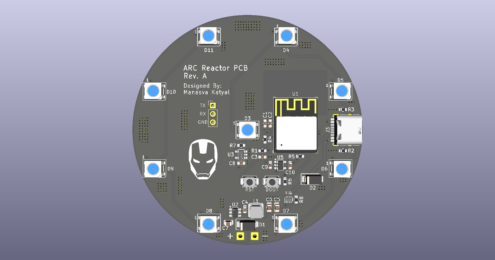

# Arc Reactor PCB

Wi-Fi controllable arc reactor board featuring an **ESP32-C3-MINI-1**, native USB flashing, a dual-diode power OR-ing circuit, and a 9-LED WS2812B addressable ring. Powered by a 2S–4S battery or USB-C.

## Features

- ESP32-C3-MINI-1 module with onboard Wi-Fi
- 9x WS2812B-B/W addressable RGB LEDs in a center-and-ring layout
- Native USB-C interface for data flashing and 5V power input
- Dual-diode power OR-ing circuit (LM66200) for seamless switching between USB and battery power
- Wide-input synchronous step-down buck converter (AP63205) supporting 2S–4S LiPo inputs
- Low-dropout regulator (AP2112K-3.3) for stable 3.3V MCU power
- SN74AHCT1G125 level shifter for reliable 3.3V to 5V WS2812B data transmission
- TVS diode (SMAJ18A) and breakout header for UART serial debugging

## PCB Layers

### Front Copper

### Internal Ground (In1)

### Internal Power (In2)

### Back Copper

## Design Files

Designed in **KiCad 10**. Includes the complete schematic, 4-layer PCB layout, Bill of Materials (BOM), Component Placement List (CPL), and fabrication files.
